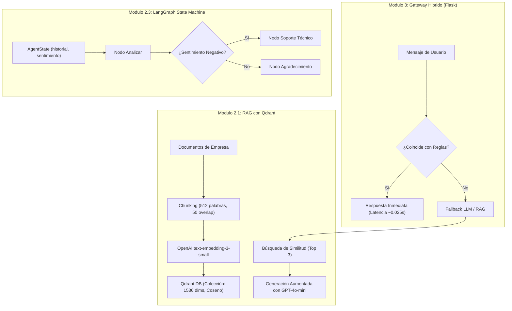

# Documentación Técnica: Plataforma de Chatbots, RAG y Grafos de Estado

**Autor:** Roberto Alejandro Chagra Martínez  
**Tecnologías:** LangGraph, LangChain, Qdrant Vector DB, OpenAI, Ollama (Llama 3.2), Flask  
**Tipo:** Arquitectura Híbrida de Agentes Conversacionales y Recuperación Aumentada  

---

## 1. Descripción del Proyecto

Plataforma modular que explora la evolución de los sistemas conversacionales modernos: desde chatbots orientados a reglas con concordancia difusa y flujos declarativos, hasta arquitecturas de grafos de estado adaptativas con **LangGraph** y sistemas **RAG (Retrieval-Augmented Generation)** con bases de datos vectoriales y un gateway híbrido en **Flask**.

---

## 2. Catálogo de Módulos

* **[`modulo_1_1.py`](file:///g:/Mi%20unidad/Drive.alumno.udg.mx/Proyectos/Desarrollo%20de%20Chatbots/modulo_1_1.py):** Motor de reglas inicial (`RuleEngine`) con concordancia difusa (`difflib.get_close_matches`, `cutoff=0.6`) tolerante a errores tipográficos sobre una base de conocimiento estática.
* **[`config/modulo_1_2.yml`](file:///g:/Mi%20unidad/Drive.alumno.udg.mx/Proyectos/Desarrollo%20de%20Chatbots/config/modulo_1_2.yml):** Especificación declarativa en YAML del flujo conversacional `transferir_monto` (recolección de *slots* `destinatario` y `monto`, validación `action_check_sufficient_funds` y ramificación condicional de confirmación).
* **[`modulo_2_1.py`](file:///g:/Mi%20unidad/Drive.alumno.udg.mx/Proyectos/Desarrollo%20de%20Chatbots/modulo_2_1.py):** Pipeline RAG de extremo a extremo:
  * Conexión con cliente vectorial Qdrant (`localhost:6333`) y creación de la colección `documentos_empresa` (`1536` dimensiones, métrica Coseno).
  * Fragmentación por ventana deslizante (`chunk_size=512`, `overlap=50`) e indexación con `text-embedding-3-small` y `PointStruct`.
  * Recuperación semántica Top-3 y generación con contexto estricto utilizando `gpt-4o-mini`.
* **[`modulo_2_2.py`](file:///g:/Mi%20unidad/Drive.alumno.udg.mx/Proyectos/Desarrollo%20de%20Chatbots/modulo_2_2.py):** Cadena de ejecución declarativa con LangChain Expression Language (`prompt | llm | StrOutputParser()`) sobre modelos de lenguaje locales ejecutados vía Ollama (`llama3.2`, `temperature=0.3`).
* **[`modulo_2_3.py`](file:///g:/Mi%20unidad/Drive.alumno.udg.mx/Proyectos/Desarrollo%20de%20Chatbots/modulo_2_3.py):** Máquina de estados cíclica/condicional con `langgraph.graph.StateGraph` (`AgentState`). Evalúa el sentimiento del último mensaje en `sentiment_node` y enruta dinámicamente mediante `route_sentiment` hacia `soporte_node` (escalamiento humano) o `finalizar_node`.
* **[`modulo_3_1.py`](file:///g:/Mi%20unidad/Drive.alumno.udg.mx/Proyectos/Desarrollo%20de%20Chatbots/modulo_3_1.py):** API REST en Flask (`POST /api/chat`) con arquitectura híbrida: resuelve consultas frecuentes mediante reglas deterministas en `~0.025s` (`mode_used: "rule_based"`) y deriva consultas abiertas al motor generativo con LangChain/Ollama (`mode_used: "llm_fallback"`).

---

## 3. Requisitos y Despliegue

* Instancia de Qdrant activa en Docker: `docker run -p 6333:6333 qdrant/qdrant`
* Ollama con modelo Llama 3.2: `ollama run llama3.2`
* Variables de entorno: `OPENAI_API_KEY` (para el módulo 2.1)
